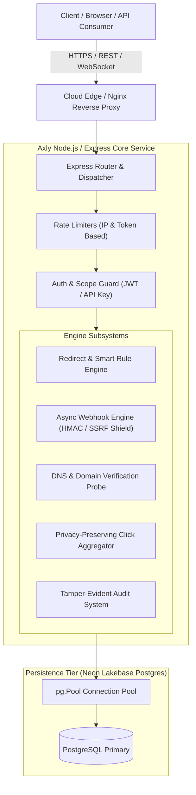
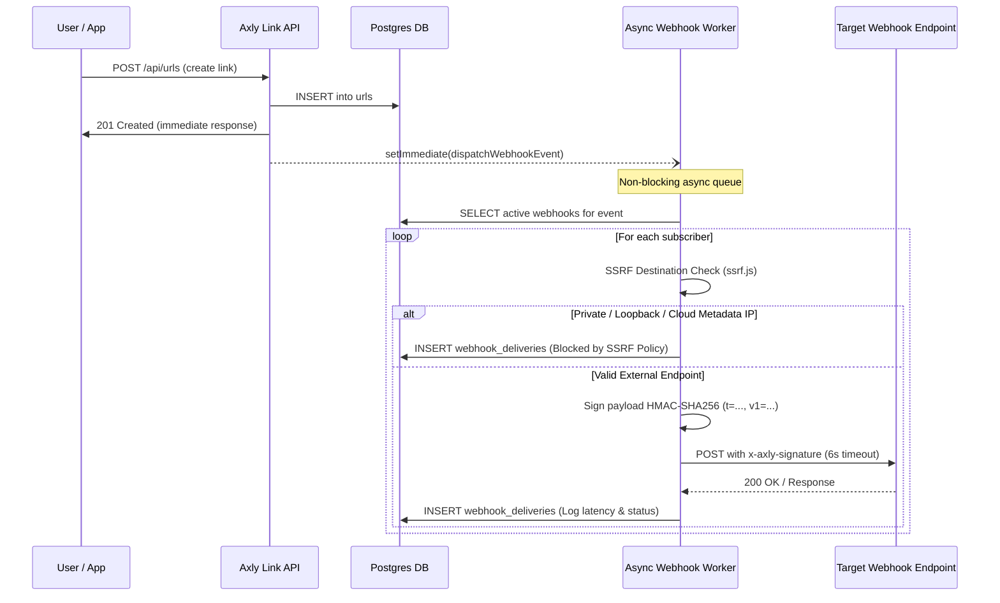
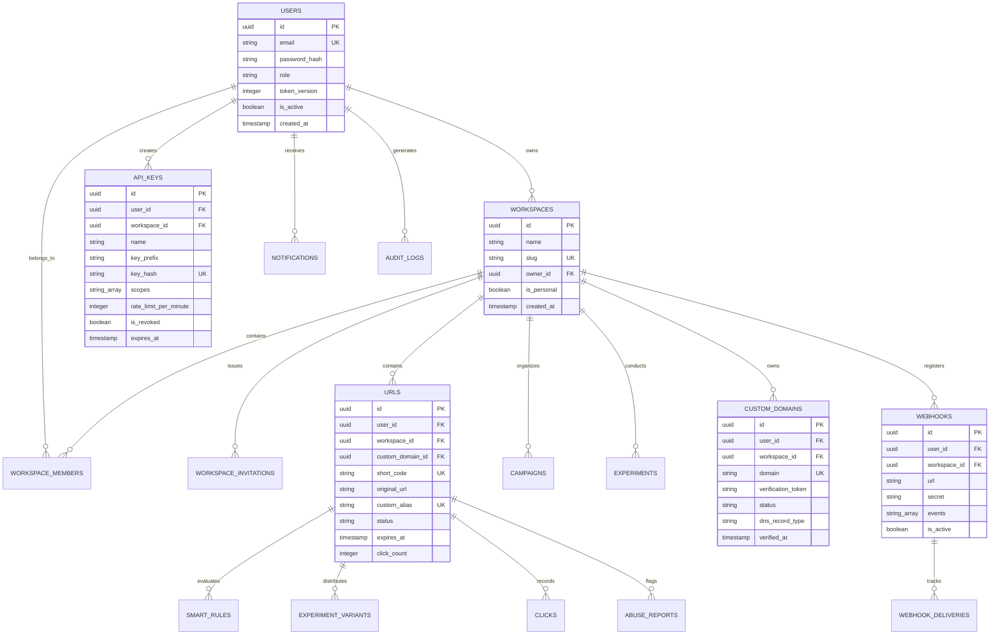

# Axly Studio Platform Architecture & Design

Axly Studio is an enterprise link intelligence and URL management platform engineered on Node.js/Express, React 18, and Neon PostgreSQL.

---

## 1. High-Level System Architecture

---

## 2. Redirection & Smart Rules Pipeline

Short link redirection execution path prioritizes sub-millisecond response times:
1. **Host Verification**: Checks if incoming request matches a verified `custom_domain` or the primary short domain (`s.axly.in`).
2. **Code Lookup**: Queries `urls` table by `short_code` (indexed with B-tree).
3. **Status Check**: Verifies link is `active` and has not expired (`expires_at > NOW()`).
4. **Smart Rule Evaluation**: Evaluates device type (`mobile`, `tablet`, `desktop`), operating system (`ios`, `android`, `windows`, `mac`), country code, or active A/B experiment variants.
5. **Password Protection Check**: If `password_hash` is present and unlocked cookie/session is missing, renders unlock challenge.
6. **Async Analytics Tracking**: Dispatches click recording asynchronously (`setImmediate` or fire-and-forget worker query) so caller latency is unaffected.
7. **HTTP 302/301 Redirect**: Emits redirect response.

---

## 3. Webhook Delivery & SSRF Shield Architecture

---

## 4. Database Relationship Diagram (ERD)

