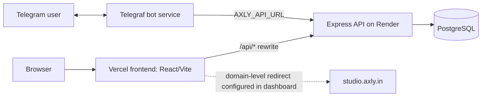

# Axly Studio architecture

This document describes the current repository structure and integration boundaries. Source code and hosting dashboards are authoritative for live behavior.

## System context

## Components

### Frontend

- Source: frontend/
- Runtime/build: React + Vite; production assets are generated into dist/.
- Routing: client-side routes are declared in src/App.jsx. Vercel must rewrite non-API paths to /index.html so direct navigation and refresh work.
- API: frontend/vercel.json proxies /api/:path* to https://api.axly.in/api/:path*.
- Secret boundary: VITE_ values are shipped to browser code. They must never contain private credentials.

### Backend/API

- Source: backend/
- Entrypoint: src/index.js; route modules are in src/routes/ and controllers in src/controllers/.
- Persistence: PostgreSQL via pg. Connection configuration is in src/config/env.js and src/db/.
- On service startup, the entrypoint validates environment configuration and runs migrations before opening the port.
- API route groups are mounted below /api: auth, urls, admin, campaigns, experiments, analytics, reports, keys, webhooks, workspaces, domains, pages, user privacy operations, notifications and Telegram account linking.
- Root paths include liveness/readiness endpoints and the short-code redirect/unlock handlers.

### Telegram bot

- Source: telegram-bot/
- Runtime: Node.js + Telegraf; independently deployable from the frontend and API.
- Startup: validates environment, checks the Telegram token through getMe, registers the command menu and starts long polling or webhook mode.
- Health server runs on PORT (default 3000). HTTP 200 means bot startup completed; it does not prove every backend feature is healthy.
- Per-user interaction/prompt state is stored in process memory in the current implementation. Restarting the process clears in-progress prompts. Do not assume durable sessions or multi-instance state coordination.

### Database

- Provider-neutral PostgreSQL connection configuration is used. The environment template describes local, Supabase and Neon-style connection URI examples, but the actual production provider must be confirmed in its hosting configuration.
- Keep credentials server-side. Use TLS where required by the provider and retain certificate verification.
- Migration code is under backend/src/db/. Service startup invokes migrations before the API listener opens; schedule releases with database backup and rollback consequences in mind.

## Request paths

### Browser API request

1. The browser calls a relative /api/... endpoint.
2. Vercel rewrites /api/:path* to the API origin configured in frontend/vercel.json.
3. Express applies common middleware such as request parsing, CORS, request logging outside tests, and API rate limiting.
4. The matching route applies authentication and scope/role requirements.
5. Controllers query PostgreSQL and return the response.

If the API host changes, update frontend/vercel.json and service environment values together, then run auth, link, page and analytics smoke tests.

### Short-link redirect

1. A request arrives at the API host/path routed for a short code.
2. Express matches the root /:shortCode redirect handler after health and API routes.
3. The redirect controller validates stored link state and destination and handles status, expiration and password rules implemented there.
4. The redirect implementation records click analytics.

The configured SHORT_DOMAIN, URLs returned by the API, DNS and hosting routing must agree. Do not infer that s.axly.in is working only because code contains that hostname.

### Telegram update

1. Telegram delivers a command/message through long polling or the configured webhook.
2. Bot middleware applies rate limiting/deduplication and adds available account/session state.
3. A handler validates input and calls Axly through AXLY_API_URL.
4. Guest shortening/QR flows work without a linked account where the handler allows it; account-specific link lists/analytics and custom alias behavior require a linked Axly account as enforced by the bot code.
5. The response is sent back through Telegram.

Account linking relies on a short-lived code and shared backend/bot configuration. The shared secret is not a Telegram token and must stay private.

## Trust boundaries

- **Browser:** user input is untrusted; never store server secrets in frontend variables.
- **API:** authoritative authentication, scope checks, validation and rate limiting. UI route guards are not an authorization mechanism.
- **Bot:** treats messages/URLs as untrusted. Keep URL validation and private-network protections in place.
- **Database:** private persistence boundary; credentials must not appear in source control, logs or client bundles.
- **Hosting/domain layer:** TLS, DNS, redirect rules, rewrite routing, secret settings and access control are configured in hosting dashboards as well as source files.

## Configuration sources

| Concern | Source of truth |
|---|---|
| Frontend scripts/dependencies | frontend/package.json |
| Frontend API rewrite and SPA fallback | frontend/vercel.json |
| Frontend routes | frontend/src/App.jsx |
| API runtime/env defaults | backend/src/config/env.js and backend/.env.example |
| API route/auth behavior | backend/src/routes/ and backend/src/middleware/ |
| Database migrations | backend/src/db/ |
| Bot commands and startup mode | telegram-bot/src/index.js and telegram-bot/src/bot.js |
| Bot message/help behavior | telegram-bot/src/handlers/ and telegram-bot/src/utils/ |
| Automated CI checks | .github/workflows/ci.yml |
